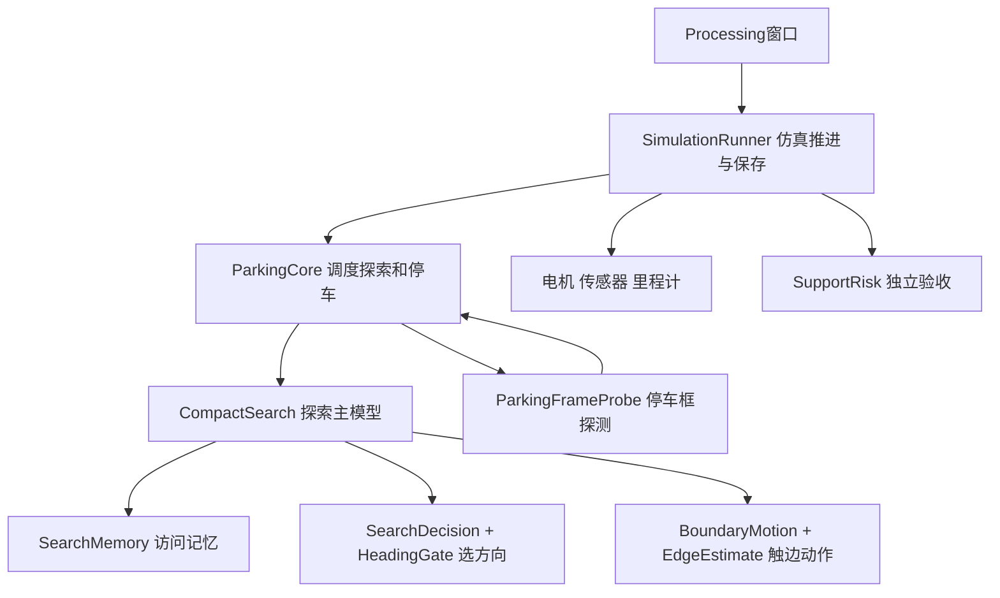

# 代码分工清单

**先打开 `simulation/ParkingSimulation/ParkingSimulation.pde`，或双击 `停车控制台.cmd`。**

当前共26份手写代码：运行Java 11份、Processing标签页6份，其余为启动、训练和独立评测。新增的趣味地图界面独立放在MapEditor.pde；生成文件在.cache，旧代码在项目外归档。

模型训练使用Python；运行、运动控制和Processing仿真使用Java。真实几何只给模拟环境和独立验收。

## 运行Java

目录：`simulation/ParkingSimulation`。每个文件头写明输入、输出与调用关系。

| 文件 | 职责 | 谁调用 |
| --- | --- | --- |
| [BoundaryMotion.java](../simulation/ParkingSimulation/BoundaryMotion.java) | 默认 vector：刹车→沿走过的路倒车或外侧轮不动转向，离边到70毫米→原地转到主模型方向→从新位置沿该方向出发；途中触新边则重新选择。自定义地图沿用原条件动作 | CompactSearch 调用；读取 EdgeEstimate、灰色格与走过的格子；原条件动作读取触边网络权重。 |
| [CompactSearch.java](../simulation/ParkingSimulation/CompactSearch.java) | 探索主模型：编码器里程计、观测特征、访问记忆和子目标执行 | ParkingCore 调用；内部使用 SearchDecision、HeadingGate、BoundaryMotion。 |
| [EdgeEstimate.java](../simulation/ParkingSimulation/EdgeEstimate.java) | 根据近期传感器和编码器观测估计直边方向与夹角 | BoundaryMotion 用来判断是否启用特殊动作。 |
| [HeadingGate.java](../simulation/ParkingSimulation/HeadingGate.java) | 普通地图默认 direction：可靠边线时方向朝内（余量=拟合半范围+20°）、出发段不经灰色格；不可靠时子目标在4米桌内证据内并离边60毫米；否则退回原凸包规则；另按局部触边线截断子目标。复杂地图按有限局部障碍点筛选方向 | CompactSearch 更新，SearchDecision 应用。 |
| [ParkingCore.java](../simulation/ParkingSimulation/ParkingCore.java) | 当前停车控制器与共用数据结构：拟合后直接开到停车点（沿途黑白矛盾计数、跳变对齐墨迹边界修正、停车位姿五路特征），证据不足退回入口（两端自适应）+条纹验证+按需横扫；停稳验收 | SimulationRunner 调用；触框前交给 CompactSearch，触框后使用 ParkingFrameProbe。 |
| [ParkingFrameProbe.java](../simulation/ParkingSimulation/ParkingFrameProbe.java) | 首次触到停车黑框后，采集足够的框边观测供几何定位使用 | 仅由 ParkingCore 的停车定位阶段调用；无独立循迹任务或旧模式。 |
| [SearchDecision.java](../simulation/ParkingSimulation/SearchDecision.java) | 组装主模型输入，施加桌内方向约束，主模型打分减去 8×检测带已搜比例，再采样目标方向 | ParkingCore 调用；不加入真实地图坐标。 |
| [SearchMemory.java](../simulation/ParkingSimulation/SearchMemory.java) | 保留访问路径与重复路径代价；记录检测覆盖（轨迹两侧110毫米）并计算候选方向的重复比例；全局直边推断仅用于普通地图，复杂地图停用 | CompactSearch 使用；SearchDecision 读取路径特征与重复比例。 |
| [SimulationRunner.java](../simulation/ParkingSimulation/SimulationRunner.java) | 仿真运行器：矩形场地、停车标记、10毫秒推进、完整轨迹保存 | Processing 主窗口调用；独立评测只使用其中的 Plant。 |
| [SupportRisk.java](../simulation/ParkingSimulation/SupportRisk.java) | 用模拟真实几何独立统计轮子支撑和严重越界 | 仅 SimulationRunner.Plant 评估使用，不进入模型输入。 |
| [WheelDynamics.java](../simulation/ParkingSimulation/WheelDynamics.java) | 电机惯性、加速、制动与反转的仿真响应 | SimulationRunner.Plant 每个10毫秒步长调用。 |

## Processing窗口与物理组件

目录：`simulation/ParkingSimulation`。每个文件头写明输入、输出与调用关系。

| 文件 | 职责 | 谁调用 |
| --- | --- | --- |
| [MotorsModel.pde](../simulation/ParkingSimulation/MotorsModel.pde) | 把左右轮PWM换成模拟轮速 | 属于 ParkingSimulation 的 PDE 标签页，由 SimulationRunner.Plant 使用。 |
| [MapEditor.pde](../simulation/ParkingSimulation/MapEditor.pde) | 窗口下方尺寸选择、随机停车框与独立趣味地图开关；画边界/墙线、撤销、应用和保存；验证可用起点 | ParkingSimulation 调用；几何只交给 SimulationRunner 的环境，不进入模型。 |
| [OdometryModel.pde](../simulation/ParkingSimulation/OdometryModel.pde) | 差速轮运动积分与整数编码器反馈 | 属于 ParkingSimulation 的 PDE 标签页，由 SimulationRunner.Plant 使用。 |
| [ParkingSimulation.pde](../simulation/ParkingSimulation/ParkingSimulation.pde) | Processing 原生停车仿真窗口；这是直接打开的主文件。 | 只调用共用 SimulationRunner，运行三个当前控制模块，不带其他窗口包装。 |
| [RobotSimulation.pde](../simulation/ParkingSimulation/RobotSimulation.pde) | 组合轮子、里程计和传感器，提供固定步长物理推进 | 属于 ParkingSimulation 的 PDE 标签页，由 SimulationRunner.Plant 使用。 |
| [SurfaceSensorModel.pde](../simulation/ParkingSimulation/SurfaceSensorModel.pde) | 五个向下传感器的黑白采样 | 属于 ParkingSimulation 的 PDE 标签页，由 SimulationRunner.Plant 使用。 |

## 独立评测

目录：`experiments/java`。每个文件头写明输入、输出与调用关系。

| 文件 | 职责 | 谁调用 |
| --- | --- | --- |
| [EvaluationScenes.java](../experiments/java/EvaluationScenes.java) | 从保存的种子和场景表重建仿真，提供统一实验设置 | ParkingEvaluation 和 SimulationChecks 使用。 |
| [ParkingEvaluation.java](../experiments/java/ParkingEvaluation.java) | 重放完整场景做停车评测；可选第四参数输出逐步触边估计、目标与动作诊断CSV | scripts/verify.py 编译后运行；不参与正常仿真。 |
| [SimulationChecks.java](../experiments/java/SimulationChecks.java) | 核对模型、方向约束、地图几何/墙传感器/碰撞；--editor-ui 实际点击窗口检查控制开关与画线 | scripts/verify.py 或独立调用，不参与正常停车。 |

## 启动、构建、训练和验收

| 文件 | 职责 |
| --- | --- |
| `停车控制台.cmd` | 唯一双击入口，调用scripts/run.ps1 |
| `scripts/run.ps1` | 编译并启动Processing窗口，支持1～4米与随机种子 |
| `scripts/build.ps1` | 编译唯一草图，产物写入.cache；WithChecks编译检查工具 |
| `scripts/Preprocess.java` | 把PDE标签页转成Java，普通运行无需手动调用 |
| `scripts/verify.py` | 模型、方向、当前64场景参考、用户两次越线故障回归、真实启动与轨迹检查 |
| `experiments/train_boundary_motion.py` | Python训练触边小网络；输出到experiments/outputs，不覆盖保留模型 |
| `experiments/java/SearchCoverageEvaluation.java` | 按真实轨迹统计找到黑框时间、检测覆盖效率、近平行重复、触边折返、越线 |
| `experiments/search_coverage.py` | 并行运行上项并汇总；不加 `-D` 即原方案 |
| `experiments/compare_search.py` | 两组结果按场景配对比较（搜索阶段） |
| `experiments/compare_parking.py` | 两组结果按场景配对比较找到黑框后的局部停车 |
| `experiments/make_tuning_scenes.py` | 按原分布生成调参或确认场景，可复制多个采样种子 |

## 模型、配置、数据

| 文件或目录 | 内容 |
| --- | --- |
| `models/exploration/policy.bin` | heading_seed4探索主模型权重 |
| `models/boundary_motion/policy.bin` | 目标方向、原方向输入的触边小模型权重 |
| `models/boundary_motion/metadata.json` | 网络格式、训练划分、参数与适用条件 |
| `configs/CURRENT_SEARCH.json` | 当前唯一模型选择与运行参数 |
| `configs/RETAINED_MODULES.json` | 三模块说明；停车模块没有独立神经权重 |
| `configs/FUN_MAP.json` | 用户点击应用后保存的最后一张地图；只保存草稿，不自动打开趣味开关 |
| `experiments/data` | 训练筛选数据、64场景与整理前参考结果 |
| `experiments/results` | 整理后和后续验收记录 |
| `runs` | 正常仿真的配置、完整压缩轨迹和结果摘要 |

## 只保留实际使用的部分

旧循迹任务、旧探索模式、旧保护器、重复运行目录、多层窗口包装和旧日志实现已经移出。ParkingFrameProbe只负责停车定位所需的短时黑框观测。电机、编码器与传感器组件只模拟运动和读数，不带旧行为控制器。

历史文件在 `E:\SEMTM0043\RepeatableParking_Archive\20261014_directory_cleanup`。工具依赖在 `E:\SEMTM0043\ProjectTools\RepeatableParking`。当前编译只读取simulation/ParkingSimulation，普通启动不加载experiments或归档。进展、否决方案和待解决问题见 [项目进展摘要.md](项目进展摘要.md)。
