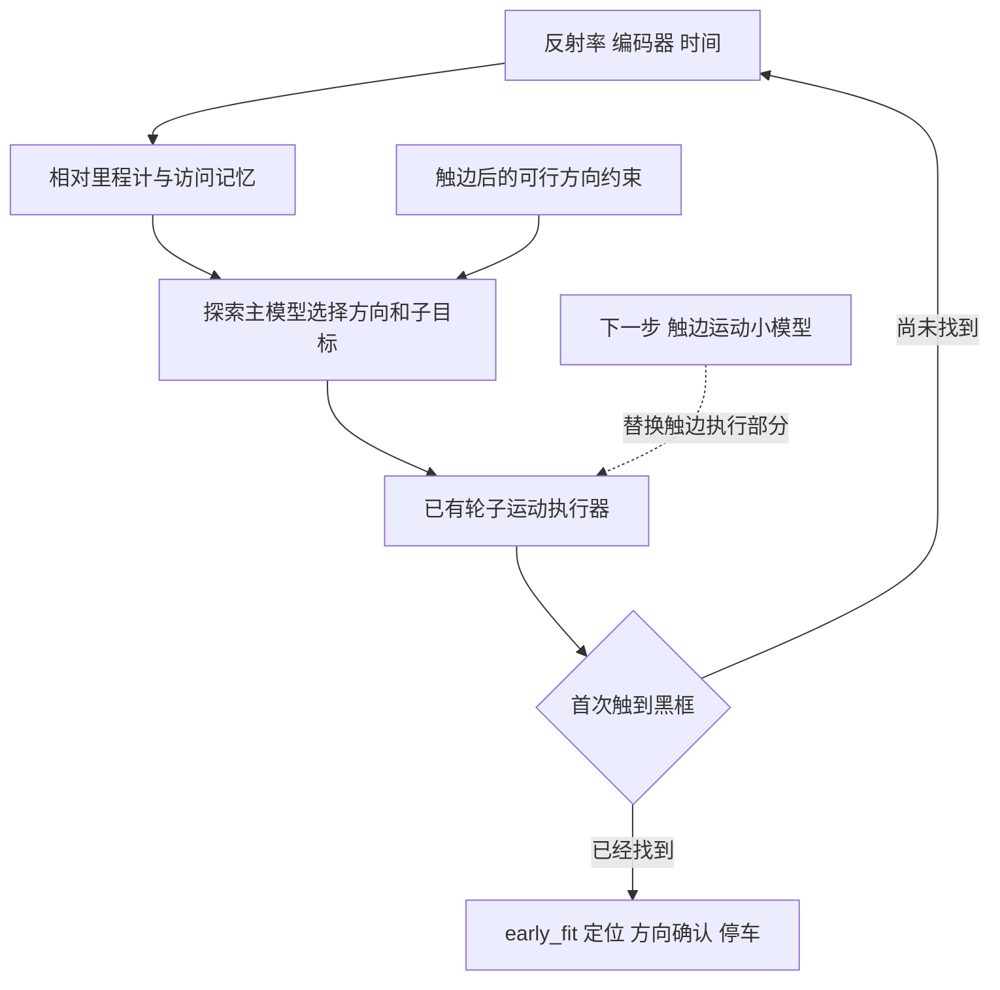

# 重复停车项目交接说明

更新日期 2026年10月14日　面向新组员和后续维护者

## 项目现在做到哪里

本项目研究小车如何在未知起点出发，探索场地、找到停车标记，再定位并停入标记内。当前工作在课程提供的 Processing 数字孪生基础上开展。小组共三人，当前维护者负责 motor 电机子系统。

我们已固定两个模块：`heading_seed4` 探索主模型及其桌内方向约束，以及触到黑框后的 `early_fit` 定位停车控制器。下一步开发第三个模块，专门优化触边后的轮子运动。第三个模块尚未实现，也没有可供运行的第三份神经网络权重。

| 模块 | 当前状态 | 回答的问题 |
| --- | --- | --- |
| 探索主模型 | 已训练并选定 | 接下来去哪个区域，朝哪个方向探索 |
| 触黑框后的定位停车控制器 | 已实现并保留 | 停车标记在哪里，如何对准并停稳 |
| 触边运动小模型 | 待开发 | 怎样把选好的方向执行出来，减少转弯越线 |

### 两种触碰事件

**触边**指探头检测到场地边界，需要调整探索方向。**触黑框**指探头首次检测到停车标记的黑线，需要开始局部定位与停车。前者触发边界处理，后者结束广域搜索计时；两者不是同一个事件。

### 从观测到停车的流程



访问记忆记录走过或探测过的区域，帮助主模型减少重复搜索。子目标是暂时要前往的局部位置，包含方向和距离；它不是停车标记的真实位置。

## 已经保留的两个模块

### 探索主模型

当前权重来自第一轮训练的 `heading_seed4`，运行时使用修正后的近期桌内点方向约束，采样温度为 0.5。最终组合由独立的32条验证场景选定，然后冻结，再在64条新场景上评价。后来追加训练的权重没有替换它。

主模型用多尺度访问记忆、相似路径特征和持续子目标来选择探索动作。32个候选由16个相对方向和两档距离组成，距离可被约束缩短。它学习按当前状态评分和选择候选，而不是背诵一条固定路线。

触边后，`HeadingGate.java` 根据近期反射率确认的桌内点和编码器里程计，构造向内收缩8毫米的凸包，限制有限子目标落在已确认的桌内区域。网络在允许的候选中自由选择；没有可确认候选时停止。8毫米是当前仿真假设，约束依赖凸形场地和较小的近期里程计误差。

权重训练时与最终运行时的方向约束版本不同，这次迁移由独立实验验证。方向检查通过是网络与约束共同作用的结果，不能解释为网络单独已经学会绝对不向外走。

推理读取反射率、编码器和时间，以及由这些观测形成的相对状态；不读取仿真真实起点、停车目标位置或真实场地尺寸。真实几何只用于训练标签、奖励和独立评估。里程计是相对估计，不是地面真值。

### 触黑框后的定位停车控制器

`early_fit` 是几何与反馈控制器，没有第二份独立神经网络权重。触框后，已有黑白观测足够时就尝试拟合标记位姿；随后利用不等宽、不同间隔的方向条纹排除朝向歧义。只有横向位置仍有歧义时才做补充扫描。

定位完成后，小车进入目标位置、调整停车方向，并等待停稳。发出零运动指令后，需要编码器连续1200毫秒没有变化，且停止状态至少持续1200毫秒，才报告完成。评估器另用真实模拟状态检查完整车身在框内且留有至少5毫米余量、方向误差不超过5度、实际连续静止至少1秒。

运行代码以 `training/boundary_heading_cert/java` 中的控制器为优先，`DigitalTwinParkingPrecision` 提供精确累计的模拟位姿、编码器和课程模型适配。不要只改后者的同名 Java 文件而期待当前控制器自动变化。

### 当前配置的唯一入口

`configs/CURRENT_SEARCH.json` 决定当前模型、权重、温度和局部停车方法。`configs/RETAINED_MODULES.json` 描述三个模块的职责和状态。模型二进制为 `models/boundary_heading_selected/policy.bin`，对应训练参数为同目录的 `policy.pt`；运行及校验不需要加载 PyTorch。

## 验证结果怎样理解

### 探索主模型的独立对照

正式对照包含1至4米正方形场地，每种尺寸16条新随机场景，普通目标与靠边目标各半。各组合使用相同场景、相同方向约束和相同解码温度。时间按模拟时间计，到第一次检测到黑框为止，不含后续停车。

| 对照组合 | 找到黑框 | 平均搜索时间 |
| --- | --- | --- |
| 旧方向权重加当前约束 | 64/64 | 290.45 秒 |
| 当前保留的 heading_seed4 组合 | 64/64 | 190.67 秒 |
| 后来继续训练的组合 | 64/64 | 191.20 秒 |

190.67秒是这一组实验的均值；保留依据是事先的验证集选择，不能把最终测试结果用作重新选权重的理由。该结果也不是全局最优证明，不能与旧地图、旧动力学或旧时间截断下的成绩直接比较。

| 方向与运动检查 | 当前结果 |
| --- | --- |
| 边界相关方向决策审查 | 635 次，错误方向为 0 |
| 有整轮支撑代理越线的场景 | 60/64 |
| 有重心或双轮心越线的场景 | 28/64 |
| 最大轮心外探 | 104.41 毫米 |

这些结果说明，有限子目标在桌内，仍不能保证车轮的转弯轨迹在桌内。当前仿真使用线外仍有支撑的虚拟边界，越线事件会被记录，但不直接作为掉落终止；它没有模拟真实桌沿的三维跌落。

### 局部停车和完整衔接

历史标称局部测试从相同首次触框位置、朝向和轮速开始，两版均64/64正确停车；触框后均时由42.47秒降到19.91秒。较慢电机及20毫秒读数延迟下，新版32/32正确停车；较快电机及50毫秒延迟下也为32/32。原慢电机组有提前报告完成的问题，不能把它的停止耗时当作成功停车均值。

这一局部测试和主模型64场景不是同一批实验，不能把190.67秒与19.91秒相加，宣称测得平均总时间。

2026年10月13日的入口衔接检查使用独立测试集第一条场景：28.21秒触到黑框，45.97秒完成停车，4597帧记录可完整回放。该检查验证权重、窗口、工作进程与回放的衔接，是单场景检查，不是新一轮64场景评价。

## 新接手者怎样运行

### 环境和位置

当前启动脚本面向 Windows PowerShell。已经验证的环境使用 Processing 4.5.7，包含其 JDK、core 库和 net 库，安装在 `E:\Processing`；Python需要可通过 `python` 命令运行，并带有标准库 `tkinter`。普通运行及当前校验使用Python标准库，不要求安装PyTorch。

项目可从交付包解压得到。推荐放在 `E:\SEMTM0043\RepeatableParking`，解压后应直接看到 `configs`、`scripts`、`models` 和 `停车控制台.cmd`，避免多套一层文件夹。项目路径多数由脚本自动推导，Processing路径仍有多处写死；放在其他盘或使用其他Processing版本时需要适配路径。

### 开始一次仿真

1. 双击项目根目录的 `停车控制台.cmd`。启动器先校验权重，再编译课程模型和当前控制器，然后打开窗口。
2. 选择矩形或正方形场地。默认3米，正式对照覆盖1至4米正方形；其他长宽比属于外推测试。
3. 设置小车和目标的随机位置，点击开始。首次看到黑框后，状态应从广域搜索转为局部定位与停车。
4. 查看是否报告停车完成；结束后检查保存的运行摘要和回放，不只凭动画判断成功。

也可以在项目根目录运行下面的命令，打开2米场地的窗口：

```powershell
powershell -NoProfile -ExecutionPolicy Bypass -File .\scripts\current_demo.ps1 -Size 2
```

`-Seed` 控制初始预览场景；窗口开始按钮可能按随机选项重新生成位置和种子。严格复现应使用已保存的配置或下面的校验脚本，而不是只依赖预览种子。

### 校验当前组合

```powershell
powershell -NoProfile -ExecutionPolicy Bypass -File .\scripts\build_boundary_heading_cert.ps1
python .\scripts\verify_current.py
```

脚本核对权重SHA-256、边界方向测试、与历史参考的推理一致性、窗口构建、单场景停车和完整回放。结果写入新的 `results/retention_20261013/check_*` 目录，不覆盖历史正式结果。正常窗口记录写入 `data/boundary_heading_runs`，包含运行配置、分段压缩轨迹和 `summary.json`。

## 下一步只优化触边运动

### 研究问题和意义

在主模型已经选出可行方向后，触边运动小模型能否在相同接触姿态和轮速下，减少轮子与重心越线，同时缩短恢复搜索的时间？解决这一问题，才能把“方向选得合理”推进到“轮子轨迹也合理”。探索网络和局部停车控制器在这一轮保持固定。

### 模块接口

| 输入或输出 | 含义 |
| --- | --- |
| 当前航向 | 编码器里程计估计的原始运动方向 |
| 目标方向或子目标 | 探索主模型通过方向约束后给出的结果 |
| 触边证据与估计轮速 | 反射率观测、近期接触信息及左右轮速度估计 |
| 运动输出 | 左右轮指令，或短时回退、转向、弧线动作 |

小模型负责执行已选方向。它可以使用中间退让动作，但不重新替代主模型决定下一块探索区域。推理接口不加入真实世界坐标、真实目标位置或仿真地图尺寸。

### 对照和验证

先保存一组触边状态，包括直边、斜向接触、角落和不同轮速。每个状态分别交给已有执行器和候选小模型，两者保持接触位置、朝向、轮速、传感器条件、动力学和主模型目标相同。训练、选型和最终测试按完整触边事件及场景分开，不能把同一事件的相邻10毫秒样本随机拆到不同集合。

首先比较严重越线次数、最大轮心外探、越线持续时间和恢复目标方向的时间，再比较完整搜索的找到率、长尾耗时和停车成功率。若只缩短转弯时间却增加严重越线，不采用；若局部改进成立，再用新的配对完整场景确认。无法继续的状态单独记为未完成，不伪装成一个惩罚时间。

这一阶段的目标是建立可验收的运动模块，不要求先选定某一种学习算法。可以先用有明确参数的短退让与转弯动作作为对照，再决定是否需要学习策略。第三个模块目前没有训练成果，本次交接也没有启动训练或实车烧录。

## 文件目录和交接材料

下面所有相对路径均从项目根目录算起。

| 路径 | 新接手者什么时候需要它 |
| --- | --- |
| configs/CURRENT_SEARCH.json | 确认当前保留模型与运行参数 |
| configs/RETAINED_MODULES.json | 确认三个模块的边界和完成状态 |
| models/boundary_heading_selected | 查找唯一保留的主模型 bin 和 pt |
| training/boundary_heading_cert/java | 阅读当前控制器与 HeadingGate |
| DigitalTwinParkingPrecision | 阅读课程模型适配与精确累计仿真 |
| scripts/current_demo.ps1 | 追踪统一启动链路 |
| results/boundary_heading_v2/final_compare | 查看64场景对照、逐场景记录和方向审查 |
| results/unlimited_optimization/RESULTS.txt | 查看局部停车方法及原评测条件 |
| data/local_opt | 核对局部停车的场景与逐场景结果 |
| archives/20261013_cleanup | 按需恢复旧实验，不作为当前默认 |

课程原始代码在外层 `RoboticsScienceAndSystems/StampC3_Template`，已有实车程序在 `MyRobot`。这些是硬件学习与后续实测的入口，当前仿真工作不等于已经给实车刷入本策略。

### 分享范围

交付包保留当前权重、必要运行代码、配置、评测依据和本说明。大体积历史归档、运行缓存和重复快照留在本机，普通GitHub仓库无需带上它们。现有2026年10月13日冻结包保持原样；本次交接包另有日期和文件校验清单。

GitHub上先阅读根目录README，再查看本说明与评测原始文件。代码完整不代表换一台电脑无需配置环境；新维护者首先应确认Processing路径和Python环境，然后执行当前校验脚本。

### 课程来源

课程 motor 指导入口为 https://semtm0043-42.github.io/motors.html ，原始代码来源为 https://github.com/paulodowd/RoboticsScienceAndSystems 。本项目的探索网络、方向约束和三模块结构是当前工程方案，不把它们当作课程统一要求。网页链接仅作为课程入口；本次运行和成绩说明依据本地代码、配置与保存的评测记录。
